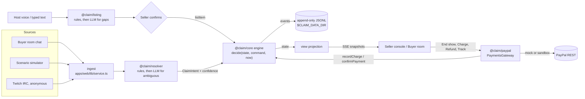

# Claim!

An AI live-sale desk for independent boutiques. A host sells clothes on a live video, and viewers claim items by typing in chat. Claim! does four things:

- turns what the host says on air into a listing;
- reads the comments, including slang and Hinglish, as claims;
- decides who got each unit, fairly and with an audit trail;
- after the show, bills each buyer once through PayPal.

This is the PayPal AI Hackathon entry (due Nov 12-13, 2026).

## The problem

When an item is on camera, dozens of comments like "sold 12 M", "me!!" and "mujhe 21 S chahiye" arrive within seconds. Someone has to work out who was first, who gets the last unit and who is only asking a question, and then chase each buyer for payment after the show.

## What the demo shows

- **Voice to listing.** The host describes an item ("number 9, sage linen button down, two smalls and a medium, thirty six"). Claim! drafts the item, the seller confirms it, and it goes on air.
- **Comments to claims.** Each comment is read as a claim, cancel, change, waitlist request, question or chatter. Anything uncertain goes to the seller's review lane instead of being granted.
- **Fair allocation.**
  - Claims are ranked by the platform's own timestamp.
  - An earlier comment that arrives late can still win within a 2-second settle window.
  - Holds, a waitlist, per-buyer spend caps and duplicate-delivery protection are all handled. The item board never oversells.
- **One cart per buyer.** "End show" builds one cart per buyer with combined shipping.
- **Close-out.**
  - Buyers with a Claim Pass (PayPal saved without a purchase) are charged merchant-initiated.
  - A decline falls back to a pay-now link.
  - The seller can refund and add tracking.

With no credentials set, payments run against a built-in mock gateway, and the UI labels them "Sandbox not connected: simulated payments".

## Quick start

```bash
npm install
npm run dev          # http://localhost:3011
```

- Requires Node 22 or newer (`engines`). The Docker image uses Node 26.
- No `.env` is needed. The LLM defaults to `mock`, which runs the deterministic rules only, and PayPal defaults to the mock gateway.
- `PORT=3015 npm run dev` changes the port.
- `npm run build && npm start` runs a production build.
- To run in Docker instead, see [docs/DEPLOY.md](docs/DEPLOY.md).

## Demo walkthrough

Open http://localhost:3011 and click **Start a demo show**. This opens `/demo/<showId>`, with the seller console on the left and a buyer's phone (`/live/<showId>?as=jess`) on the right.

The show is seeded from three host transcripts:
- #12 Blue Cable Knit Cardigan, $34, M x2 and L x1;
- #7 Black Satin Slip Dress, $48, S x1, M x2 and L x1;
- #21 Rust Floral Wrap Skirt, $29, S x1, M x2 and L x2.

#12 starts on air. Simulations run against whichever item is on air. Pick one in the scenario menu at the top of the console, then click **Simulate**.

The outcomes below were measured by driving this exact order through the HTTP API, with mock payments and rules only. A different order changes the stock each step sees, and so changes the results.

| # | Do this | What happens |
|---|---|---|
| 1 | *(optional)* **Voice listing**: **Use a sample**, then **Draft listing**, then **Confirm and put on air**. Then click **#12** in the Run sheet to go back. | The draft parses #9 "Sage Linen Button Down" at $36.00, S x2 and M x1. It carries one warning to confirm: "price read from a bare number (36)". In Chrome the mic uses the browser's SpeechRecognition. Typing works everywhere. |
| 2 | On #12, run **4 buyers race for 2 items**. | ava "SOLD 12 M" is GRANTED and dana "12 M mine!!" is GRANTED. ben "me M please" is WAITLIST #1 and cleo "sold M 🙏" is WAITLIST #2. **Why?** on a ticket shows the timestamps that decided it. |
| 3 | Click **#7** in the Run sheet, then run **Late-arriving earlier comment**. | gia "7 S sold" lands first and is granted. hal sent "sold 7 S" 280 ms earlier, but it arrives about 0.9 s later, inside the 2 s window. hal takes the last S and gia moves to the waitlist. The audit says "pre-empted ... arrived 894ms after the grant, inside the 2000ms settle window". hal has no Claim Pass, so he gets a 5-minute pay-now hold. If it lapses, the unit goes to gia. |
| 4 | Click **#21**, then run **One buyer, three items, one cart**. | nora "sold 21 M and 12 L" gives two grants from one comment. "claim 7 M too 🛍️" gives a third. |
| 5 | Run **Messy slang burst**, then **Hinglish burst**. | Each comment ends up as GRANTED, WAITLIST, QUESTION or CHATTER, or goes to REVIEW. Of the 20 comments in the two bursts, 3 are granted, 3 waitlisted, 4 are questions, 3 chatter and 7 go to review (details in [docs/DEMO-SCRIPT.md](docs/DEMO-SCRIPT.md)). |
| 6 | In the **Needs you** review panel, approve isha's "21 L pakka". She named the size, so L is preselected and the button reads **Approve L · rust**. Then **Reject** kendall_b's "me me me 🙋‍♀️". | isha becomes GRANTED with a pay-now hold. kendall_b becomes REJECTED. All 7 reviews in this run carry the cause chip "Unsure" (`low-confidence`). |
| 7 | **End show**. You land on the close-out page. Click **Charge 4 Claim Pass carts · $232.00**. | The carts are ava $42.00, dana $42.00, nora $111.00 and shopwithsam $37.00. nora's three items are one cart with $0.00 shipping, because the subtotal is at least $100. Three carts are charged. dana's card declines with `INSTRUMENT_DECLINED`, which the mock is scripted to do. The button then becomes a status card: "Every Claim Pass cart is charged". |
| 8 | On dana's card, click **Offer a pay-now link**, then the link icon next to the new link (labelled "Open pay-now link"; it opens a new tab), then **Pay with PayPal**. | Captured: $34.00 item plus $8.00 shipping. dana's supplementary cart is marked charged. The other option, **Release to waitlist**, hands dana's unit to ben, a Claim Pass holder, so the seller can charge again. |
| 9 | On nora's charged cart, click **Refund** (for example $5), then **Add tracking** (USPS, UPS, FEDEX or DHL, plus a number). | "Refund sent" and "Tracking added; PayPal notifies the buyer". A second refund submitted with the same key returns the first refund. |
| 10 | **Audit** (console header) | Every engine decision is listed with its reason. |

**About the review panel.**
- Each card shows a plain reason, for example "Didn't say which size or colour.", with the resolver's own text under **Resolver detail**.
- When the buyer did not name a variant, the button reads **Pick a variant to approve** until you choose one.
- **Approve N ready** (shown when two or more cards have item and variant known) and the keyboard shortcuts J/K (move), A (approve) and R (reject) also exist. They are not used in the run above, because extra approvals change the stock the later steps see.

**Cancel, then waitlist promotion** is a separate scenario. Run right after step 2, dana posts "nvm cancel 12 😅", her unit is freed, and ben is promoted from the waitlist. That changes steps 7-8, because dana no longer has a cart.

The phone on the right is a buyer room. A viewer can claim with buttons or chat.
- **Get Claim Pass** opens a sheet with a spend cap. In mock mode it has a **Save PayPal** button plus a "card declines at close-out" checkbox for demoing the decline path. In sandbox mode the sheet mounts PayPal's v6 save session instead.
- After the show, the room shows one of four states:
  - "Finish checking out" while something is owed; after a decline the card reads "Your Claim Pass charge didn't go through", with a pay button that goes to `/pay`;
  - "Your order is being closed out" while a Claim Pass charge is pending;
  - "You're all paid", with a receipt, refunds and "Shipped · CARRIER number".

## Architecture



- `packages/core`: the shared contract (`ChatComment`, `ClaimIntent`, `ShowItem`, `PaymentsGateway`) and the event-sourced claim engine. Pure TypeScript, no I/O.
- `packages/resolver`: comment to intent. Deterministic rules first, then an optional LLM stage whose answers are checked against the comment text and capped.
- `packages/listing`: host utterance to item draft.
- `packages/llm`: provider adapters: `anthropic`, `openai`, `groq`, `gemini`, `openai-compat`, `claude-cli` and `mock`.
- `packages/paypal`: the PayPal sandbox gateway and a deterministic mock, behind the same interface.
- `apps/web`: a Next.js 16 app. One long-running Node process holds every show in memory and appends each event to `<CLAIM_DATA_DIR>/<showId>.jsonl`. On restart, a show is rebuilt by replaying its log; this was measured across a container restart.

Details, including why it is single-process: [docs/ARCHITECTURE.md](docs/ARCHITECTURE.md).

### How fairness works

All of this is in `packages/core/src/decide.ts` and `config.ts`.

- **Order.** Claims are ranked by `(platformTs, comment id, unit index)`.
  - Twitch comments use Twitch's own `tmi-sent-ts`.
  - Buyer-room comments use the server's receive time.
  - Arrival order does not decide who wins.
- **Settle window (2,000 ms).** A grant stays provisional for 2 s on the engine clock. A claim with an earlier timestamp that arrives inside the window takes the unit from the latest provisional holder, who goes to the waitlist. After the window the grant is final, and a late claim joins the waitlist. Paid or already-billed units are never pre-empted. The 2 s figure combines two numbers from the `config.ts` comment:
  - anonymous Twitch IRC lag measured at p90 426 ms;
  - an LLM budget of p95 under 1.5 s. The measured LLM latency is far above that; see Limitations.
- **No overselling.** A unit is granted only if one is free. Otherwise the claim is waitlisted.
- **Waitlist.** When a hold lapses or a buyer cancels, the waitlist is promoted in timestamp order.
- **Holds and Claim Pass.**
  - With a Claim Pass, a grant is auto-confirmed.
  - Without one, it is a pay-now hold with a lease: 5 minutes in the demo, 10 by default.
- **Caps.** A buyer's projected show total, shipping included, is capped at $150 by default. A Claim Pass can set a lower cap. A claim that would cross the cap goes to review, and so does a waitlist promotion that would.
- **Review lane** (the **Needs you** panel). These never auto-grant:
  - an intent below confidence 0.8;
  - an ambiguous variant;
  - an unknown item;
  - a cancel of a paid unit.
- **Unlisted items.** A claim for an item that is not listed yet is parked and applied when the item is listed. At end of show it becomes a "never listed" review.
- **Idempotency.** A comment delivered twice is applied once, keyed on comment id and intent index.
- **Audit.** Every event carries a human-readable `reason`, and the Audit drawer shows them.

## PayPal integration

Every call below is implemented in `packages/paypal/src/sandbox.ts` (request bodies in `bodies.ts`). The same `PaymentsGateway` interface has a mock implementation that the app uses when no credentials are set.

| Purpose | Call | Notes | Docs |
|---|---|---|---|
| OAuth | `POST /v1/oauth2/token` (`client_credentials`) | Token cached until 60 s before expiry; a 401 refreshes once. | [Authentication](https://developer.paypal.com/api/rest/authentication/) |
| v6 JS SDK client token | `POST /v1/oauth2/token` with `response_type=client_token` | For the browser save session. | [Web SDK v6](https://developer.paypal.com/upgrade/ec/guide/Web%20SDK%20v6/) |
| Claim Pass, step 1: setup token | `POST /v3/vault/setup-tokens`, `GET /v3/vault/setup-tokens/{id}` | `payment_source.paypal`: `usage_type: MERCHANT`, `customer_type: CONSUMER`, `vault_instruction: ON_PAYER_APPROVAL`, plus a `merchant_customer_id`. | [Payment Method Tokens v3](https://developer.paypal.com/api/payment-tokens/v3), [Save PayPal without purchase](https://developer.paypal.com/api/payment-tokens/save-without-purchase/paypal) |
| Claim Pass, buyer approval in the browser | v6 SDK `createInstance`, then `findEligibleMethods({ paymentFlow: "VAULT_WITHOUT_PAYMENT" })`, then `createPayPalSavePaymentSession`, then `session.start(...)` | `packages/paypal/src/browser.ts`. In sandbox mode the buyer room's Claim Pass sheet loads it through the API actions `clientToken`, `passSetup` (creates the setup token) and `passApprove` (exchanges it for a vault id). Verified against a live sandbox on 2026-10-05. | [v6 save-payment sample](https://github.com/paypal-examples/v6-web-sdk-sample-integration/tree/main/client/components/paypalPayments/savePayment/html) |
| Claim Pass, step 2: payment token (vault id) | `POST /v3/vault/payment-tokens`; `DELETE /v3/vault/payment-tokens/{id}` | Exchanges the approved setup token for a `vault_id`. Delete treats 404 as done. | [Payment Method Tokens v3](https://developer.paypal.com/api/payment-tokens/v3) |
| Close-out charge, buyer not present | `POST /v2/checkout/orders` with `intent: CAPTURE` and `payment_source.paypal.vault_id` | One purchase unit: `invoice_id`, `custom_id`, item lines, and an `item_total` + `shipping` breakdown. `stored_credential {payment_initiator: MERCHANT, usage: SUBSEQUENT}` is sent by default and is sandbox-unverified (`PAYPAL_STORED_CREDENTIAL=false` drops it). A decline comes back as a result, not an exception. | [Orders v2](https://developer.paypal.com/api/orders/v2) |
| Pay-now fallback | `POST /v2/checkout/orders` with `experience_context` (`user_action: PAY_NOW`, `shipping_preference: GET_FROM_FILE`, return and cancel URLs) | The buyer approves at PayPal, and the return URL is `/pay/<showId>`. | [Orders v2](https://developer.paypal.com/api/orders/v2) |
| Capture | `POST /v2/checkout/orders/{id}/capture`; `GET /v2/checkout/orders/{id}` | | [Orders v2](https://developer.paypal.com/api/orders/v2) |
| Refund | `POST /v2/payments/captures/{id}/refund` | Partial amounts are supported; `note_to_payer` is optional. | [Payments v2](https://developer.paypal.com/api/payments/v2) |
| Tracking | `POST /v2/checkout/orders/{id}/track` | `capture_id`, `tracking_number`, carrier enum (`OTHER` + name otherwise), `notify_payer`. | [Orders v2](https://developer.paypal.com/api/orders/v2), [Add tracking](https://developer.paypal.com/track-orders) |
| Ship-to address | `GET /v3/vault/payment-tokens/{id}`, then `purchase_units[0].shipping` on the vault order | Close-out reads the address the buyer keeps on the saved wallet (`payment_source.paypal.shipping`) and sends it with the charge; a pay-now capture brings it back from `GET_FROM_FILE`. Verified against a live sandbox on 2026-10-06. Only the seller's close-out and ledger receive it. | [Payment Method Tokens v3](https://developer.paypal.com/api/payment-tokens/v3), [Orders v2](https://developer.paypal.com/api/orders/v2) |
| Webhook verification | `POST /v1/notifications/verify-webhook-signature`, behind `POST /api/paypal/webhook` | The raw body is spliced in verbatim. The route answers 401 on a bad signature, 503 without `PAYPAL_WEBHOOK_ID`, 502 when PayPal cannot be asked, and 200 for every genuine event; repeat deliveries are ignored. Capture, refund and reversal events show on the close-out cart; `VAULT.PAYMENT-TOKEN.DELETED` revokes the Claim Pass. | [Webhooks v1](https://developer.paypal.com/api/webhooks/v1) |
| Webhook registration | `GET` / `POST /v1/notifications/webhooks` | Eight event types (`WEBHOOK_EVENTS` in `bodies.ts`). | [Webhooks v1](https://developer.paypal.com/api/webhooks/v1), [Event names](https://developer.paypal.com/api/rest/webhooks/event-names/) |
| Negative testing | `PayPal-Mock-Response` header (opt-in) | Forces declines in sandbox. | [Request headers](https://developer.paypal.com/negative-testing/request-headers) |

**Idempotency (`PayPal-Request-Id`).** [Idempotency docs](https://developer.paypal.com/api/rest/reference/idempotency/).
- **Vault charge:** the request id is the cart's invoice id, `<showId>-<buyerKey>[-<seq>]` (truncated to 108 characters). A retried or double-clicked close-out returns the same order instead of charging twice.
- **Pay-now:** uses `<requestId>-paynow`, so it never replays a declined vault charge.
- **Refunds:** the close-out form sends one key per intended refund. A double submit with the same key returns the first refund; this was measured against the mock.
- **Other calls:** setup tokens, payment tokens and captures get a fresh UUID per call, reused across that call's retries.

**Retries.** Only idempotent-safe calls are retried, twice by default. They retry on network errors and timeouts, HTTP 408, 429, 500, 502, 503 and 504, and `409 PREVIOUS_REQUEST_IN_PROGRESS`. Webhook registration is never retried.

**Money.** Integer cents everywhere, converted to PayPal decimal strings at the edge. Every cart is validated before sending: items plus shipping must equal the total.

### Mock vs sandbox

| | Mock (default) | Sandbox |
|---|---|---|
| Selected when | `PAYPAL_CLIENT_ID` or `PAYPAL_CLIENT_SECRET` is unset, or `PAYPAL_GATEWAY=mock` | both are set |
| Talks to | nothing: in-memory, deterministic, PayPal-shaped ids | `https://api-m.sandbox.paypal.com` only (a live host is refused) |
| Claim Pass in the buyer room | **Save PayPal** button (`savePass`, mock only), auto-approved | PayPal v6 save session in the sheet: `clientToken`, then `passSetup`, then PayPal's window, then `passApprove`. Verified against a live sandbox on 2026-10-05 |
| Simulated buyers | some get a Claim Pass (race: ava, dana, ben), and dana's card declines | no Claim Pass: their grants are pay-now holds, so Claim Pass carts come only from real buyer-room buyers |
| Declines | buyers who tick "card declines at close-out", and the race scenario's `dana`, decline with `INSTRUMENT_DECLINED` | real issuer response, or `PayPal-Mock-Response` |
| Pay-now link | goes straight to `/pay/<showId>?token=...` | PayPal's checkout, which returns to `/pay/<showId>`; the page captures on arrival, with no second click |
| Idempotency, duplicate invoice, over-refund | modelled | PayPal's own |

The PayPal package has its own sandbox setup guide and a 16-step spike script (`npx tsx packages/paypal/scripts/spike.ts`); see [packages/paypal/README.md](packages/paypal/README.md). **None of the sandbox code has run against a real sandbox account yet.** It is unit-tested against a fake `fetch`, and request bodies are checked against PayPal's published OpenAPI specs.

## How good is the comment resolver

**Scored once, on a held-out set.** Held-out v3 has 350 comments sampled from seven public replays of live sales:
- 2 numbered US shows;
- 1 US show with slot letters;
- 4 Indian one-piece-at-a-time shows.

The gold labels are 52 claims (49 naming a catalogue item), 1 change, 2 cancels, 77 questions and 218 other. A second annotator, working blind, labelled 151 rows; Cohen's kappa over the six kinds was 0.989.

The source of `packages/resolver` and `packages/llm` was hashed before the run and unchanged after it. Source: `eval/heldout-v3-failures.md`. The raw result is `eval/results/2026-10-05T12-00-59.md`, a local file because `eval/results/` is git-ignored.

| config | kind accuracy | grants | harmful grants | grant precision | grant recall (n=49) |
|---|---|---|---|---|---|
| naive regex ("sold N") | .634 | 0 | 0 | n/a | 0 |
| rules only (what the app runs with `LLM_PROVIDER=mock`) | .743 | 16 | 3 | .813 | .265 |
| rules + claude-cli | .703 | 16 | 3 | .813 | .265 |
| claude-cli only | .803 | 12 | 3 | .750 | .184 |

- **Definitions.** A *grant* is a claim or change with an item code at confidence 0.8 or above, which the engine would hold without the seller. A grant is *harmful* if the comment was not a claim, or names a different item. Everything not granted goes to the review lane or is ignored as a question or chatter.
- **The precision target (0.95) was missed.** All 3 harmful grants were bare two-digit numbers typed while a different item was on screen: two guesses in a chat number game and one likely typo.
- **Recall is low.** 36 of 49 claims were not auto-granted. The largest group (12) is shows where one stand-in item carries every variant, so the comment's size or price cannot pick one. That needs a data-model change.
- **About claude-cli.** These rows used the local `claude` CLI. The client defaults to the `haiku` model; the result file does not record the model (unverified).
  - Latency for LLM-routed comments, batched: p50 7,273 ms, p95 11,240 ms.
  - Single-comment calls: p50 3,368 ms, p95 6,141 ms.
  - Cost: $0.17 per 1,000 comments for rules + cli, $0.29 for cli only, as reported by the CLI.

**After the run (post-hoc, not a held-out score).** One rule was added after reading these failures: a bare code for an item that is not on screen goes to review, and is not sent to the LLM either. Re-scored with rules only, v3 drops from 16 grants and 3 harmful to 10 grants, 0 harmful and recall .204 (`eval/results/2026-10-05T12-12-03.md`). v3 is therefore in-sample for that rule. The next honest number needs a fresh held-out v4.

The dev sets are not quoted as accuracy here: they were read while writing the rules, and they score far higher.

**Design rule.** Auto-grant only comments about the item on air, or comments with an explicit claim word ("sold", "mine", "claim", "chahiye", ...). Everything else goes to the review lane. An LLM answer is checked against the comment text:
- invented codes are dropped;
- a code the comment does not name is dropped, unless it is the on-screen item;
- a claim with no claim word is capped at 0.75;
- an unavailable variant is capped at 0.6, and an underspecified one at 0.75.

So the LLM can only lower confidence or fill a gap; it cannot push an unclear comment over the grant line.

## Limitations and what is not yet verified

- **Sandbox runs (2026-10-05).** Against a real PayPal sandbox app and US sandbox buyer:
  - In the app: a buyer saved PayPal from the buyer room's Claim Pass sheet (v6 popup: `clientToken`, `passSetup`, then `passApprove`), three chat and tap claims confirmed on the pass, and close-out charged the cart as one merchant-initiated order against the vault id (COMPLETED, $102.00).
  - The gateway spike (`packages/paypal/scripts/spike.ts`) passed 16 of 18 checks: v6 eligibility and approval, vault id, vault and `stored_credential` charges, idempotent replay, duplicate `invoice_id` refused, decline mock, pay-now after a decline, refund and refund replay, tracking.
  - A merchant-initiated order does not copy the wallet's address onto the order by itself, which was the spike's one failing check. Close-out now reads it from the saved wallet and sends it (2026-10-06, live: a $1.00 vault order with the address COMPLETED, and the order read back from PayPal carried the same address).
  - The webhook route is tested with signed deliveries against the mock (unit and browser tests). Real PayPal deliveries need a public HTTPS URL; see [docs/DEPLOY.md](docs/DEPLOY.md).
  - In sandbox mode, simulated buyers have no Claim Pass, so the scripted decline (dana) and the simulated Claim Pass charges only happen in mock mode. The demo video is recorded in sandbox with one real buyer-room Claim Pass; see [docs/DEMO-SCRIPT.md](docs/DEMO-SCRIPT.md).
  - Pay-now in the app: the return to `/pay` was checked up to PayPal refusing an order nobody had approved (`ORDER_NOT_APPROVED`, 2026-10-06). The order stays open and the page sends the buyer back to PayPal. A complete in-app checkout payment has not been recorded yet.
- **Groq is the only provider run with a real API key** (free tier, `openai/gpt-oss-20b`, 2026-10-05). On all five dev sets, rules + Groq made zero harmful grants, and on dev-real3 it raised grant recall from 0.522 to 0.565. These sets were read while writing the rules, so the numbers are in-sample; no held-out set has been scored with Groq. The `anthropic`, `openai` and `gemini` adapters are unit-tested against fakes only, and the held-out numbers above come from the local `claude` CLI.
- **Measured LLM latency is far above the settle window's budget.** With the `claude` CLI, a single comment took p50 3.4 s against the 1.5 s budget. Through Groq, a single comment took p50 788 ms and p95 8,894 ms (n=12), so the median fits the budget and the tail does not. When a live LLM is configured, a comment the rules route to it is applied when the answer returns. It can then pre-empt only a grant made less than 2 s before that moment; a grant made earlier is already final, so the comment queues on the waitlist instead. Rule-resolved comments are unaffected: the "p95 resolve" KPI read 4.57 ms after the measured demo run (4.74 ms in an earlier identical run), with rules only.
- **Single process.** All state is in one Node process's memory, with a local append-only log. One instance per data directory; no horizontal scaling. Vercel-style serverless does not work as-is; see [docs/DEPLOY.md](docs/DEPLOY.md).
- **No authentication.** Every route is open, so anyone with a show URL can act as the seller. Buyer rooms never receive ship-to addresses, but `?scope=seller` is a scope, not access control.
- **One currency.** Gateway calls send USD only.
- **Sources.** Twitch chat is read anonymously over IRC, read-only. Other platforms are not wired.

## Tests

```bash
npm test             # vitest: packages, eval metrics, web service
npm run typecheck    # tsc -b packages/*
```

`npm test` measured 24 files and 540 tests passing (2026-10-06). The PayPal OpenAPI conformance suite reads PayPal's published specs from `PAYPAL_OPENAPI_DIR`. It defaults to a path outside this repo, and when the specs are absent the suite reports as skipped.

A Python Playwright script drives the real UI end to end: one seller and two buyers, close-out with a decline, pay-now, refund, tracking and reload persistence. Run it as `python apps/web/e2e/e2e.py <base-url> <out-dir>`. It needs Python `playwright`, Google Chrome, and a server in mock mode. It passed 23/23 checks on 2026-10-06, against a production build with mock payments and Groq live; the added checks cover ship-to addresses, the ledger's Ship to column and CSV, and signed webhooks.

`npm run eval` runs the resolver evaluation over `eval/data`; see the usage comment in `eval/run.ts`.

## Licence

MIT. See [LICENSE](LICENSE).
