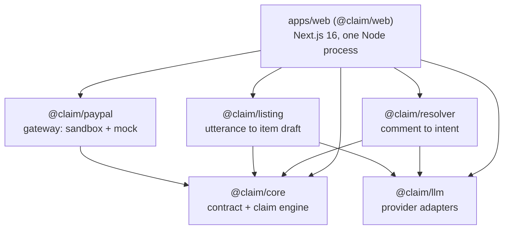
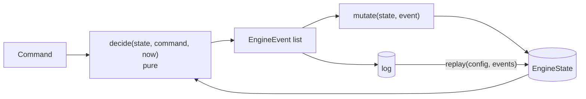
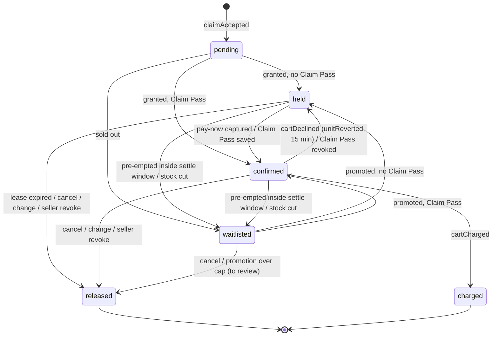
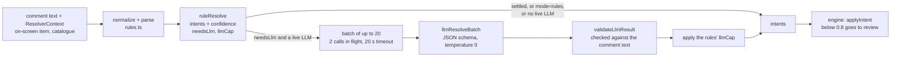
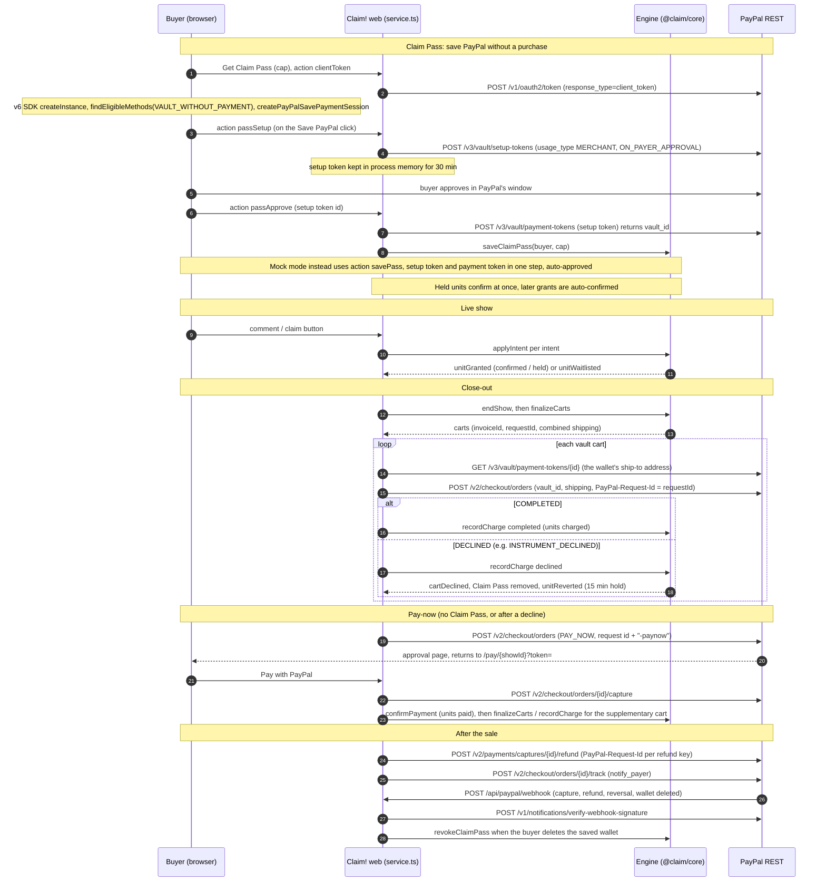

# Architecture

This document describes the code as it is on 2026-10-05. File references are relative to the repo root.

## 1. Packages and boundaries

The repo uses npm workspaces with TypeScript ESM (NodeNext). Packages ship their `.ts` source; there is no build step for them. Relative imports say `.js` and mean `.ts`. `apps/web/next.config.ts` transpiles the packages and strips the `.js` suffix with a small Turbopack loader (`apps/web/build/strip-js-ext.cjs`).

| Package | Owns | Does not do |
|---|---|---|
| `packages/core` | `contract.ts`: the types every package shares (`ChatComment`, `ClaimIntent`, `ShowItem`, `ResolverContext`, `PaymentsGateway`). The engine: `types.ts`, `decide.ts`, `state.ts`, `engine.ts`, `carts.ts`, `projections.ts`, `config.ts`, `util.ts`. | Any I/O, clocks or randomness. Time comes in as an argument. |
| `packages/resolver` | `normalize.ts`, `lexicon.ts`, `rules.ts` (stage 1), `llm-stage.ts` (stage 2), `resolve.ts` (orchestration). | Granting anything. It only emits intents with a confidence. |
| `packages/listing` | `rules.ts` / `numbers.ts` / `lexicon.ts` parse a spoken listing ("two mediums and one large, thirty four dollars"). `llm.ts` fills gaps. `confirmListing` applies the seller's edits. | Listing an item. The web app sends `listItem` to the engine only after the seller confirms. |
| `packages/llm` | `LlmClient` with JSON-schema completions. Adapters: `anthropic` (default model `claude-haiku-4-5`); `openai` (`gpt-4.1-mini`), `groq` (`openai/gpt-oss-20b`, reasoning effort `low`) and `gemini` (`gemini-2.5-flash-lite`), all three through `openai-compat`; `claude-cli` (spawns the local `claude` binary, default `haiku`); and `mock`. `factory.ts` reads `LLM_PROVIDER`, which defaults to `mock`. | Prompting. The prompts live with their callers. |
| `packages/paypal` | `sandbox.ts` (REST calls), `bodies.ts` (pure request-body builders), `http.ts` (OAuth, retries, timeouts), `errors.ts`, `money.ts`, `parse.ts`, `mock.ts` (deterministic in-memory gateway), `env.ts` (`createGateway`: sandbox or mock), `browser.ts` (the v6 JS SDK save session, loaded by the buyer room in sandbox mode; untested against a live sandbox). | Deciding what to charge. Carts come from the engine. |
| `apps/web` | `lib/service.ts` (the show service: ingestion, simulator, Twitch, payments, actions), `lib/store.ts` (JSONL file store), `lib/view.ts` (the snapshot the UI renders), `lib/scenarios.ts`, `lib/twitch.ts`, `lib/seed.ts`. Routes: `GET`/`POST /api/shows`, `GET`/`POST /api/shows/[showId]`, `GET /api/shows/[showId]/stream` (SSE). Pages: `/`, `/demo/[id]`, `/seller/[id]`, `/seller/[id]/closeout`, `/live/[id]`, `/pay/[id]`. | Fairness decisions. Every allocation goes through `@claim/core`. |

**Every mutation goes through one endpoint.** `POST /api/shows/[showId]` takes `{ action, ... }`, and `ShowService.act` switches on it. The actions are:

| Group | Actions |
|---|---|
| Show | `start`, `end`, `setStream`, `onAir` |
| Comments and listings | `comment`, `parseListing`, `listItem`, `simulate`, `twitch`, `review` |
| Claim Pass | `savePass` (mock only: setup token and payment token in one step, auto-approved); `clientToken`, `passSetup`, `passApprove` (sandbox: the v6 save session's three server calls) |
| Payments | `finalize`, `chargeAll`, `payNowCart`, `payNowHolds`, `releaseHolds`, `capture`, `refund`, `tracking` |

## 2. The engine: an event-sourced claim desk

### Model

- **`decide`** (`decide.ts`) never touches its input.
  1. It clones the state into a draft and first expires any pay-now leases that lapsed by `now`, so every decision sees current stock.
  2. It handles the command. Each event it emits is applied to the draft at once, so later steps of the same command see earlier effects.
  3. It returns the events. The same `(state, command, now)` always gives the same events.
- **`mutate`** (`state.ts`) applies one event in place. It is used only on the engine's own draft and during replay. `replay(config, events)` rebuilds state from the log alone.
- **`execute` / `createEngine`** (`engine.ts`) run decide on a clone, keep the new state, and append the events.
- **Event fields.** Every event carries `seq`, `at` (the engine clock) and a human-readable `reason`. The audit log is these reasons.

### Commands (`types.ts`)

| Group | Commands |
|---|---|
| Listing and stock | `listItem`, `updateInventory` |
| Comments | `applyIntent` (one per intent the resolver returned) |
| Claim Pass | `saveClaimPass`, `revokeClaimPass` |
| Payments during the show | `confirmPayment` (pay-now capture) |
| Seller overrides | `sellerGrant`, `sellerRevoke`, `sellerReassign` |
| Review lane | `approveReview`, `rejectReview` |
| Clock | `tick` (no-op; it exists to trigger lease expiry) |
| Close-out | `endShow`, `finalizeCarts`, `recordCharge` (`completed` or `declined`) |

### Events (`types.ts`)

| Event | Meaning |
|---|---|
| `itemListed`, `inventoryUpdated` | catalogue changes (a cut in stock bumps the latest unpaid holders to the waitlist) |
| `claimAccepted` | a claim of N units, each with key `(platformTs, commentId, n)` |
| `claimParked` | a claim for an item not listed yet; replayed in key order when it is listed |
| `unitGranted` | `held` (pay-now, with `leaseExpiresAt`) or `confirmed` (Claim Pass). Carries `settleUntil`, `promoted`, and `preempted` (the unit it displaced, if any) |
| `unitWaitlisted` | `sold-out`, `preempted` or `bumped` |
| `unitReleased` | `lease-expired`, `buyer-cancel`, `changed`, `seller-revoke` or `to-review`, with `refundDue` |
| `unitConfirmed` | via `claim-pass` or `payment` (sets `paid`) |
| `unitReverted` | back to a pay-now hold (after a decline or a revoked Claim Pass) |
| `unitReassigned` | a seller moves a unit to another buyer |
| `reviewOpened`, `reviewResolved` | the review lane |
| `intentIgnored`, `commandRejected` | questions or chatter; invalid commands, with the reason |
| `claimPassSaved`, `claimPassRevoked` | Claim Pass state (an optional per-show cap) |
| `showEnded`, `cartsFinalized`, `cartCharged`, `cartDeclined` | close-out |

### Unit lifecycle

### Allocation rules (`decide.ts`)

- **Total order.** `compareKeys` orders by `platformTs`, then comment id, then unit index.
- **Grant.** A unit is granted if `available = variant qty - active units > 0`. Active means `held`, `confirmed` or `charged`.
- **Settle window.** `DEFAULT_SETTLE_WINDOW_MS = 2000` (`config.ts`). When nothing is free, the engine looks at holders whose key is later than the new claim and that are still provisional:
  - not paid;
  - not in a cart;
  - `now < settleUntil`.

  The latest such holder is pre-empted to the waitlist, and the new claim takes the unit. With none, the claim joins the waitlist. The window is measured on the engine clock at application time, not at platform time.
- **Waitlist promotion.** `promote` fills free units from the waitlist head in key order. A head that would break its cap is released `to-review` (`promotion-over-cap`) and the next head is tried. Units the seller granted or approved are cap-exempt.
- **Caps.** `exposure` projects the buyer's show total (active units plus the new ones, combined shipping included). The effective cap is the smaller of the show cap (`cap.maxCents`, default $150) and the buyer's Claim Pass cap. A claim for N units checks every prefix 1..N, because with free shipping over a threshold, fewer units can cost more than all of them.
- **Confidence.** An actionable intent below `confidenceThreshold` (0.8) opens a `low-confidence` review. Questions and chatter emit `intentIgnored`.
- **Idempotency.** Any event that carries a `commentId` marks it seen. `applyIntent` returns no events for an intent key it has already seen; the key is the comment id, or `<id>#<n>` for later intents of a multi-intent comment.
- **Cross-item change.** "cancel 7 take 8" becomes a claim on 8 plus a cancel of 7.
- **Review causes** (`ReviewCause`): `low-confidence`, `over-cap`, `ambiguous-variant`, `unknown-item`, `no-item`, `never-listed`, `promotion-over-cap`, `paid-cancel`, `change-unavailable`. Approving dispatches the (optionally patched) request with `source: "review"`, which bypasses the cap.

### Carts (`carts.ts`)

`finalizeCarts` builds one cart per buyer from `confirmed` units not yet in a cart, ordered by each buyer's earliest claim.

- **Shipping.** `shippingFor(units, subtotal)` is $8.00 for the first item plus $2.00 for each extra, free at a $100.00 subtotal or more (`DEFAULT_CONFIG.shipping`).
- **Supplementary carts.** A buyer billed before (after a decline, or a unit promoted after close-out) gets a supplementary cart. Its shipping is the combined rule over everything billed, minus the shipping already billed.
- **Ids.**
  - `invoiceId = <showId>-<buyerKey>[-<seq>]`, at most 127 characters. PayPal's `invoice_id` is unique per merchant, so a double close-out is refused.
  - `requestId = invoiceId` truncated to 108 characters. This is the `PayPal-Request-Id`, so a retried create returns the original order.
- **Charge mode.** `vault` if the buyer has a Claim Pass, else `pay-now`. Flags: `over-cap`, `seller-override`, `pay-now-balance`, `supplementary`.
- **`recordCharge`.** On `completed`, the units become `charged`. On `declined`:
  - the cart is marked declined;
  - the buyer's Claim Pass is removed;
  - every unpaid unit reverts to a pay-now hold for `declineLeaseMs` (15 min).

### Configuration defaults (`config.ts`)

| Setting | Default | Demo shows (`apps/web/lib/service.ts`) |
|---|---|---|
| currency | USD | same |
| pay-now lease | 10 min | **5 min** |
| lease after a decline | 15 min | same |
| settle window | 2,000 ms | same |
| review threshold | 0.8 | same |
| buyer cap | $150 including shipping | same |
| shipping | $8 + $2 per extra item, free at $100 or more | same |

## 3. The resolver pipeline

**When the LLM runs.** The web app resolves each comment with `resolveAll`.
- With a non-mock `LLM_PROVIDER` it uses `mode: "auto"`: rules first, and the LLM only for comments the rules flag as `needsLlm`.
- Otherwise it uses `mode: "rules"`. `LLM_PROVIDER` defaults to `mock`, so by default the app runs rules only.
- If an LLM call fails or times out, those comments keep their rule answer.

### Stage 1: rules (`rules.ts`), precision first

- **A claim word scores 0.95.** "sold", "mine", "claim", "chahiye", "me" and similar are claim cues.
- **A bare code scores 0.85, sometimes 0.75.**
  - A number with no claim word scores 0.85 when it has at least two digits or carries a size or colour.
  - A lone single digit scores 0.75 and goes to review, because it collides with counts, game picks and answers.
- **Caps below the grant line** (most use `REVIEW_CAP` = 0.75):
  - a bare code for an item not on screen. This rule was added after held-out v3. It does not route the comment to the LLM, and `commentEvidence` stops counting the code as a claim cue, so the LLM cannot re-grant it;
  - one stray word beside a bare code: 0.7;
  - a claim-word comment with words but no item reference: 0.75;
  - an unknown number or an object outside the catalogue: 0.6;
  - a question mark: 0.75;
  - a number that is both a code and a size: 0.5.
- **Variant fit caps any intent.** An unavailable variant gives 0.6, an underspecified one 0.75, and an item named only by its title 0.85.
- **Other kinds.**
  - questions are 0.9 with a `?`, otherwise 0.75;
  - cancels are 0.85 to 0.92;
  - changes are 0.88 when the source or variant is clear, else 0.72;
  - waitlist requests are capped at 0.9.
- **`llmCap`.** When the comment is positively *not* this viewer claiming now, the rules set `llmCap = 0.75`. That covers someone else's claim, a negation, a past report, a hypothetical, an object outside the catalogue, an ambiguous or unknown number, and a size or colour with no claim word. Whatever the LLM reads into such a comment, the seller confirms it.
- **`needsLlm`.** Ambiguous comments go to stage 2: weak cues, Hindi without a known cue, item-like words without a cue, a cancel that contradicts a claim, and similar.

### Stage 2: LLM (`llm-stage.ts`)

- **Request.** One call per batch, with a strict JSON schema (`RESOLVE_SCHEMA`) and `temperature: 0`. The schema has `results[]`, each with `kind`, `items[{code, size, color, qty}]`, `from`, `confidence` and `reason`.
- **System prompt.** `SYSTEM_PROMPT` explains the six kinds and the "not the speaker's claim" cases, and says "no claim word, no claim". It also says which item a comment may refer to, and carries a Hinglish and Spanish glossary.
- **Catalogue.** The user prompt carries a catalogue with the on-screen item marked "ON SCREEN NOW".
- **`validateLlmResult(raw, ctx, text)`.** Every answer is checked against the comment's own evidence (`commentEvidence`):
  - a code that is not in the catalogue is dropped, and the answer is capped at 0.6; with nothing left, the comment becomes a question at most 0.3;
  - a code the comment does not name is dropped, unless it is the on-screen item and the comment has no position word ("the last one", "pichla wala");
  - a claim or change with no claim word is capped at 0.75;
  - the variant fit caps the answer at 0.6 (unavailable) or 0.75 (underspecified);
  - several items in one answer are capped at 0.9, and any LLM confidence at 0.97.
- **Then** the rules' `llmCap` is applied on top.

### Confidence policy

| Confidence | Engine behaviour |
|---|---|
| 0.8 or above, claim/change/waitlist with a resolvable item and variant, within cap | granted, waitlisted or pre-empting, per the allocation rules |
| below 0.8 | `low-confidence` review |
| question / other | `intentIgnored`; shown as QUESTION or CHATTER |

`resolve()`, the single-intent API, caps a multi-intent comment at 0.6. The web app uses `resolveAll` and applies every intent, so "sold 21 M and 12 L" yields two grants.

For measured accuracy, see "How good is the comment resolver" in the [README](../README.md#how-good-is-the-comment-resolver).

### Voice to listing (`packages/listing`)

1. **Rules.** `parseListing` runs the rules first: spoken numbers, sizes, colours, counts and price.
2. **LLM, only for gaps.** The LLM is asked only when a field is missing or confidence is below 0.7. It may fill a gap but never overrides a field the rules read; a disagreement becomes a warning.
3. **Seller approval.** The result is always a draft. `confirmListing` applies the seller's edits, and only then does the app send `listItem`.

The demo seed parses its three transcripts with rules only.

## 4. Payment flow

Every step below is wired into the web app. The Claim Pass save, the vault close-out charge with the wallet's ship-to address, refunds and tracking have run against a live PayPal sandbox; in mock mode the same calls go to the in-memory mock gateway.

The decline handling is defensive. `chargeOne` turns a thrown error (a missing vault, a network failure) into a decline, so a single failure moves that cart to pay-now instead of aborting the whole close-out. In mock mode, a vault the mock forgot on restart is re-saved once and retried.

## 5. Why single-process

One Node process holds the whole system.

1. **State.** `apps/web/lib/server.ts` keeps one `ShowService` on `globalThis.__claimShows`. Its `Map` holds every loaded show: the engine state, comments, orders, Claim Pass vault ids and SSE listeners. Setup tokens waiting for a buyer's PayPal approval sit in a second in-memory map for 30 minutes.
2. **Ordering is free.** `decide` and `mutate` are synchronous. Each command runs to completion on the event loop before the next starts, so two claims for the last unit cannot interleave, with no locks or transactions. Fairness then comes from the platform timestamps, not from whichever request won a race.
3. **Persistence is an append-only file per show.** `<CLAIM_DATA_DIR>/<showId>.jsonl` is written with `appendFileSync`. A show is loaded lazily on first access by replaying its engine events (`hydrate`), and a torn last line from a crash is skipped. A restart with the same data directory picks up where it left off; this was measured in Docker with a named volume.
4. **Push is in memory.** The SSE route subscribes a listener on the show. Snapshots are coalesced every 80 ms, with `retry: 1500` and a ping every 15 s.
5. **Timers run in the process.** A 1-second `tick` per loaded show expires leases. Simulator comments are scheduled with `setTimeout`, and the Twitch reader holds a WebSocket.

**What breaks with two processes.** Each process would hold its own copy of a show. Two claims for the last unit could be granted by different processes, which oversells. A buyer connected to process A would never see a grant made by process B. Both would append to the same log file. The design therefore assumes exactly one instance per data directory.

**What a restart loses.** It loses in-flight simulations, Twitch connections, pending Claim Pass approvals (the buyer starts again) and the mock gateway's in-memory vaults; the service re-saves mock Claim Passes when it finds them missing. It does not lose engine state.

**Scaling out** would need three things, none of them implemented:
- a single writer per show (for example, routing by `showId`);
- a shared durable log;
- a pub/sub channel for SSE fan-out.

For a hackathon demo and a single boutique's show, one process is enough, and it keeps the fairness argument simple: one clock, one queue.
